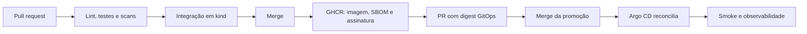
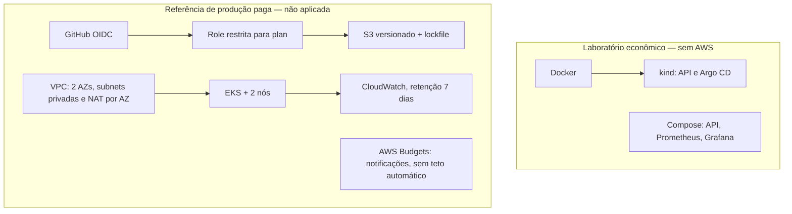

# Deployment Flow — DevOps / SRE

Laboratório de entrega contínua de uma API FastAPI: do pull request à implantação em Kubernetes com Argo CD, imagem versionada por digest e observabilidade com Prometheus e Grafana.

O projeto demonstra CI/CD, GitOps, segurança de imagens e operação de serviços. A API é pequena e stateless para concentrar o trabalho no fluxo de entrega e na infraestrutura.

**[Executar o laboratório](docs/getting-started.md) · [Evidências](docs/validation.md) · [Observabilidade](observability/README.md) · [Runbooks](docs/runbooks.md)**

## Resultados comprovados

Validações de **14/10/2026**. Os resultados registram essas execuções; não representam monitoramento contínuo nem capacidade de produção.

| Área | Resultado | Evidência |
|---|---|---|
| Implantação GitOps | Argo CD `Synced / Healthy`, duas réplicas prontas e imagem conferida contra o digest declarado | [Implantação](docs/evidence/argocd-local-2026-10-14.json) |
| Verificação HTTP | Endpoints, readiness, métricas e cálculo aprovados pelo smoke test | [Registro de validação](docs/retomada.md) |
| Observabilidade | Target da API `UP`, regras validadas e quatro painéis RED com dados no Grafana | [Prometheus e Grafana](docs/evidence/observability-compose-2026-10-14.json) |
| Carga no Compose | 2.771 requisições, zero falhas, 100% dos checks e p95 de 8,72 ms; execução de 50 s com até 10 usuários virtuais | [Saída do k6](docs/evidence/load-compose-2026-10-14.txt) |

O CI também concluiu lint, testes, análise de segredos e vulnerabilidades, validação de manifests, integração em kind e carga. [Registro da execução e limitações](docs/validation.md).

## Fluxo de entrega

A publicação gera a imagem e abre um PR de promoção. Após o merge, Argo CD reconcilia o digest declarado no Git. O fluxo de release inclui assinatura Cosign; a verificação criptográfica independente da imagem e o exercício de rollback no cluster ainda estão pendentes. [Detalhes da publicação e verificação](docs/supply-chain.md).

## Arquitetura e escopo

| Ambiente | O que está implementado e validado |
|---|---|
| Kubernetes local com kind | API com duas réplicas, probes, recursos limitados e reconciliação por Argo CD |
| Compose local | Outra instância da API, Prometheus, Grafana, dashboard RED e teste de carga |
| AWS / Terraform | Arquitetura de referência e configuração validada estaticamente; nenhum recurso AWS criado |

**O Prometheus do Compose monitora a API do Compose.** A coleta dos pods Kubernetes ainda é uma evolução planejada. O SLO de 99,9% em 30 dias é uma meta proposta, sem histórico suficiente para comprovar seu cumprimento.

## Experimentar localmente

Comece pelo [guia de execução](docs/getting-started.md), que reúne pré-requisitos, API, implantação local e GitOps. Para métricas e dashboard, siga o [guia de observabilidade](observability/README.md).

Com a stack Compose iniciada:

| Serviço | Acesso local |
|---|---|
| API / documentação interativa | http://localhost:8000/docs |
| Prometheus | http://localhost:9090 |
| Grafana / dashboard | http://localhost:3000/d/deployment-flow |

## Decisões e documentação

- [Arquitetura, decisões e limitações](docs/architecture.md).
- [Publicação, assinatura, SBOM e proveniência](docs/supply-chain.md).
- [Runbooks de incidente, rollback e recuperação](docs/runbooks.md).
- [AWS, OIDC, estado remoto e FinOps](docs/aws-finops.md).
- [Configuração do repositório, environments e tokens](docs/github-owner.md).
- [Evidências das validações](docs/validation.md) e [fontes oficiais](docs/sources.md).

## Próximas etapas

- Exercitar incidente, rollback GitOps e recuperação no cluster com evidências.
- Integrar a observabilidade aos pods Kubernetes e configurar notificações de alertas.
- Medir disponibilidade e orçamento de erro durante uma janela representativa.
- Evoluir a referência AWS após revisão de custos e autorização para criar recursos.
