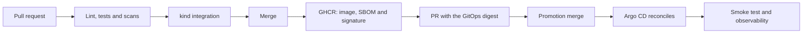
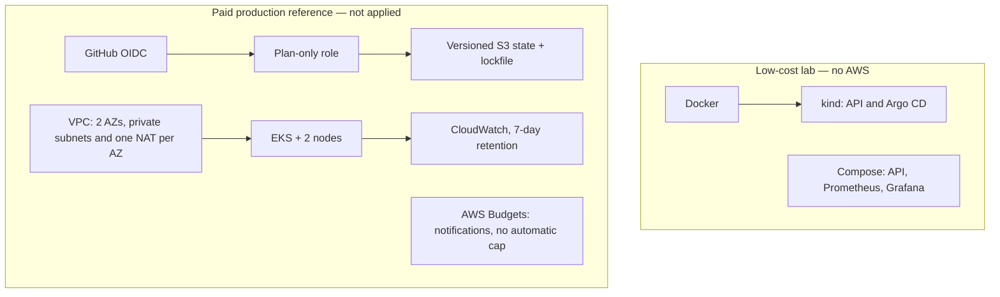

# GitOps Delivery Platform

**English** · [Português](README.pt-BR.md)

A continuous delivery lab for a FastAPI service: from pull request to a Kubernetes deployment reconciled by Argo CD, with the image pinned by digest and observability in Prometheus and Grafana.

It covers CI/CD, GitOps, image security and service operations. The API is small and stateless on purpose, so the work stays on the delivery path and the infrastructure.

**[Run the lab](docs/getting-started.md) · [Evidence](docs/validation.md) · [Observability](observability/README.md) · [Runbooks](docs/runbooks.md)**

The detailed docs are in Portuguese.

## Verified results

Validations from **2026-10-14**. They record those runs; they are not continuous monitoring or a production capacity claim.

| Area | Result | Evidence |
|---|---|---|
| GitOps deployment | Argo CD `Synced / Healthy`, two ready replicas and the running image checked against the declared digest | [Deployment](docs/evidence/argocd-local-2026-10-14.json) |
| HTTP checks | Endpoints, readiness, metrics and the calculation route pass the smoke test | [Validation log](docs/retomada.md) |
| Observability | API target `UP`, rules validated and four RED panels with data in Grafana | [Prometheus and Grafana](docs/evidence/observability-compose-2026-10-14.json) |
| Load on Compose | 2,771 requests, zero failures, 100% of checks and p95 of 8.72 ms; a 50 s run with up to 10 virtual users | [k6 output](docs/evidence/load-compose-2026-10-14.txt) |

CI also runs lint, tests, secret and vulnerability scans, manifest validation, a kind integration and a load test. [Run record and limitations](docs/validation.md).

## Delivery flow

A release builds the image and opens a promotion PR. After that PR is merged, Argo CD reconciles the digest declared in Git. The release signs the image with Cosign; independent cryptographic verification of the image and a rollback exercise in the cluster are still pending. [Publishing and verification details](docs/supply-chain.md).

## Architecture and scope

| Environment | What is implemented and validated |
|---|---|
| Local Kubernetes with kind | API with two replicas, probes, resource limits and reconciliation by Argo CD |
| Local Compose | A second API instance, Prometheus, Grafana, a RED dashboard and a load test |
| AWS / Terraform | Reference architecture and statically validated configuration; no AWS resources created |

**The Compose Prometheus monitors the Compose API.** Scraping the Kubernetes pods is planned. The 99.9% 30-day SLO is a proposed target, without enough history to show it is met.

## Try it locally

Start with the [getting started guide](docs/getting-started.md), which covers prerequisites, the API, the local deployment and GitOps. For metrics and the dashboard, follow the [observability guide](observability/README.md).

With the Compose stack running:

| Service | Local URL |
|---|---|
| API / interactive docs | http://localhost:8000/docs |
| Prometheus | http://localhost:9090 |
| Grafana / dashboard | http://localhost:3000/d/deployment-flow |

## Decisions and documentation

- [Architecture, decisions and limitations](docs/architecture.md).
- [Publishing, signing, SBOM and provenance](docs/supply-chain.md).
- [Runbooks for incidents, rollback and recovery](docs/runbooks.md).
- [AWS, OIDC, remote state and FinOps](docs/aws-finops.md).
- [Repository settings, environments and tokens](docs/github-owner.md).
- [Validation evidence](docs/validation.md) and [official sources](docs/sources.md).

## Next steps

- Exercise an incident, a GitOps rollback and recovery in the cluster, with evidence.
- Scrape the Kubernetes pods and configure alert notifications.
- Measure availability and error budget over a representative window.
- Extend the AWS reference after a cost review and approval to create resources.

## License

MIT. See [LICENSE](LICENSE).
