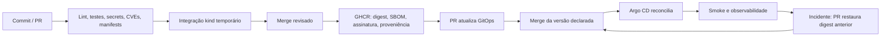
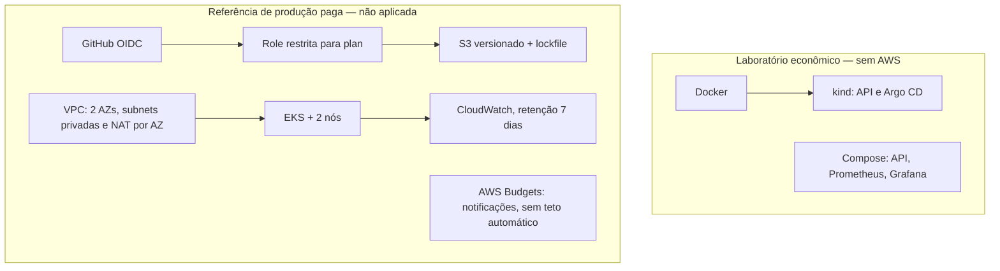

# Deployment Flow — portfólio DevOps/SRE
API FastAPI pequena para demonstrar entrega contínua, operação e segurança de supply chain. O laboratório usa recursos locais; a arquitetura AWS é uma referência paga separada e não é aplicada automaticamente.

Implantação local validada: Argo CD `Synced`/`Healthy`, duas réplicas prontas e smoke HTTP aprovado. Consulte o [ponto de retomada](docs/retomada.md) para as evidências e próximos passos.

## Início rápido econômico
Pré-requisitos: Linux AMD64 (ou WSL2 com Docker acessível), Python 3.14.8, Git, Docker Engine + Compose v2, kubectl, kind 0.33.0, curl. Recomenda-se 4 CPUs, 8 GiB de RAM e 15 GiB de disco livres para kind + Argo CD. `make` é opcional.

```bash
git clone https://github.com/tommmdl/deployment-flow-mock.git
cd deployment-flow-mock
python3 -m venv .venv
.venv/bin/pip install --require-hashes -r app/requirements-dev.txt
.venv/bin/ruff check app scripts
.venv/bin/ruff format --check app scripts
.venv/bin/pytest -q
.venv/bin/uvicorn app.main:app --host 127.0.0.1 --port 8000
# Em outro terminal:
python3 scripts/smoke.py http://127.0.0.1:8000
```

API: `GET /`, `POST /api/calculate` com `{"a":2,"b":3}`, `GET /health/live`, `GET /health/ready`, `GET /metrics`. Readiness é falsa fora do ciclo de vida; liveness independe dela. O serviço é stateless, sem banco ou autenticação no laboratório.

```bash
python3 scripts/install_tool.py kind
python3 scripts/install_tool.py kubectl
export PATH="$PWD/artifacts/bin:$PATH"
bash scripts/lab.sh prepare
bash scripts/lab.sh deploy
bash scripts/lab.sh verify
kubectl --context kind-deployment-flow -n deployment-flow port-forward service/api 8000:8000
# Finalizar o port-forward com Ctrl+C antes de remover:
bash scripts/lab.sh remove
```
Todos os comandos Kubernetes dos scripts usam explicitamente `kind-deployment-flow`. Eles não alteram seu contexto global. A imagem local tem tag `local`; produção usa digest imutável. Alterações locais exigem novo build/load e reinício do Deployment (`kubectl --context kind-deployment-flow -n deployment-flow rollout restart deployment/api`), pois reaplicar a mesma tag não muda o Pod template.

## GitOps com Argo CD
O manifesto oficial Argo CD 3.5.4 está vendorizado, com origem e checksum em [docs/argocd-source.txt](docs/argocd-source.txt). Não usamos a branch mutável `stable` durante instalação.

1. Configure o proprietário conforme [docs/github-owner.md](docs/github-owner.md), revise e faça merge deste PR.
2. A primeira release publica a imagem, assina e abre um PR para substituir o digest inicial. Faça merge desse PR. O digest zerado é marcador de bootstrap e **não é uma imagem executável**.
3. O overlay production referencia o Secret `ghcr-pull`: crie o Secret docker-registry no namespace deployment-flow fora do Git antes da sincronização. Se tornar o pacote público, remova a referência em um PR. Como este repositório foi criado privado, Argo CD também precisa de credencial read-only de repositório; forneça pela UI/CLI e nunca faça commit de Secret.
4. Execute `bash scripts/lab.sh prepare` e `bash scripts/lab.sh argocd`. Não execute o deploy local após ativar o Argo no mesmo namespace: ele sobrescreveria a versão declarada.
5. Acesse com `kubectl --context kind-deployment-flow -n argocd port-forward svc/argocd-server 8080:443`, use HTTPS em localhost e a senha inicial fornecida pelo Secret do Argo. Rotacione a senha após login. Configure a credencial Git na UI se necessário.
6. Aguarde `Synced` e `Healthy`, confirme o digest com `kubectl --context kind-deployment-flow -n deployment-flow get deployment api -o jsonpath='{.spec.template.spec.containers[0].image}'` e execute `bash scripts/lab.sh verify`.

O AppProject limita fonte, destino e tipos de recursos. O Argo CD padrão ainda tem privilégios amplos no cluster: esta instalação é exclusiva do laboratório.

## Fluxo completo

PRs executam em runners hospedados efêmeros com token read-only, sem secrets. A publicação executa apenas no push de `main`, após CI e environment `release`. A atualização GitOps usa um token dedicado no environment `gitops`, para que o novo PR dispare CI (PRs criados por `GITHUB_TOKEN` normalmente não disparam outros workflows). Mudanças somente em GitOps/docs não publicam outra imagem.

Verifique antes da promoção (requer login GHCR se pacote privado):
```bash
cosign verify ghcr.io/tommmdl/deployment-flow-mock@sha256:DIGEST \
  --certificate-identity=https://github.com/tommmdl/deployment-flow-mock/.github/workflows/release.yml@refs/heads/main \
  --certificate-oidc-issuer=https://token.actions.githubusercontent.com
# Atestação GitHub adicional: repositório público ou plano compatível
gh attestation verify oci://ghcr.io/tommmdl/deployment-flow-mock@sha256:DIGEST --repo tommmdl/deployment-flow-mock
```
BuildKit publica SBOM e proveniência como attestations OCI, além da atestação GitHub quando disponível no plano. Em repositório privado, a atestação GitHub adicional só roda com a variável `ENABLE_GITHUB_ATTESTATIONS=true`; SBOM/proveniência BuildKit continuam obrigatórias. Não afirmamos um nível SLSA certificado. A verificação é operacional; uma admission policy obrigatória ainda é evolução futura.

## Operação e evolução
- [Observabilidade, dashboard, SLO e carga](observability/README.md).
- [Runbooks de incidente, rollback e recuperação](docs/runbooks.md).
- [Decisões, ameaças e limitações](docs/architecture.md).
- [AWS, OIDC, estado remoto e FinOps](docs/aws-finops.md).
- [Configurações do proprietário](docs/github-owner.md).
- [Evidências reais](docs/validation.md) e [fontes oficiais](docs/sources.md).



## Troubleshooting
| Sintoma | Verificação / ação |
|---|---|
| Docker socket indisponível | `docker info`; iniciar Docker Desktop/Engine no host. Não execute os scripts com sudo por rotina. |
| kind lento / OOM | Liberar RAM/disco; conferir `docker stats`, `docker system df`; não remover recursos de outros projetos. |
| ImagePullBackOff | Verificar digest, visibilidade GHCR e pull secret; o digest de bootstrap não existe. |
| Argo Repository error | Repositório privado exige credencial read-only no Argo; não no YAML. |
| Argo OutOfSync | Conferir branch/path, commit e permissões do AppProject; evitar `kubectl edit` com self-heal. |
| Readiness falha | `kubectl --context kind-deployment-flow -n deployment-flow logs -l app=api` e `describe pods`. |
| Scan falha | Investigar CVE e atualizar dependência/base; não adicionar ignore genérico. DB/schema externos exigem rede. |
| PR GitOps não roda CI | Usar `GITOPS_PR_TOKEN` dedicado, não o token padrão; conferir proteção/env. |
| Dashboard sem dados | Gerar tráfego, aguardar scrape + janela; conferir targets em localhost:9090. |
